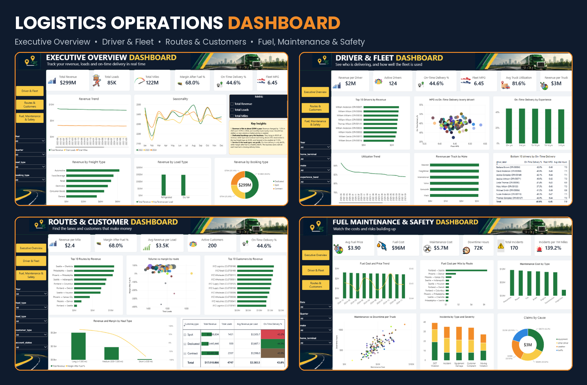
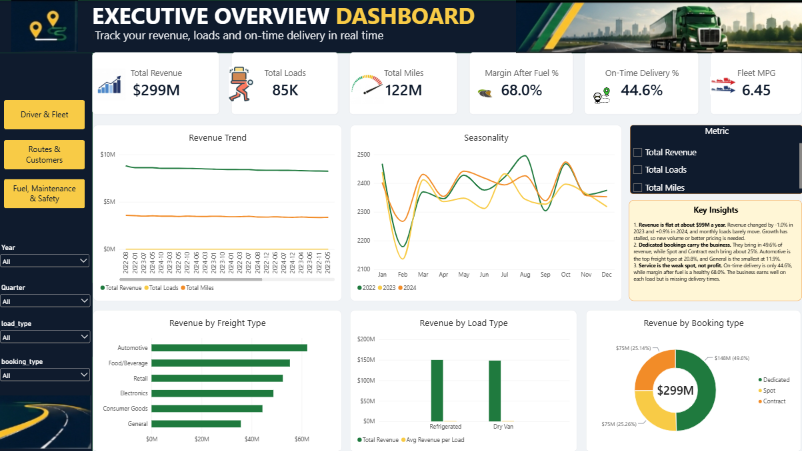
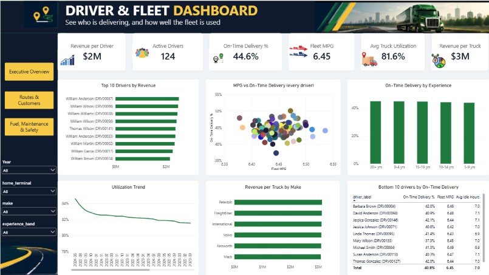
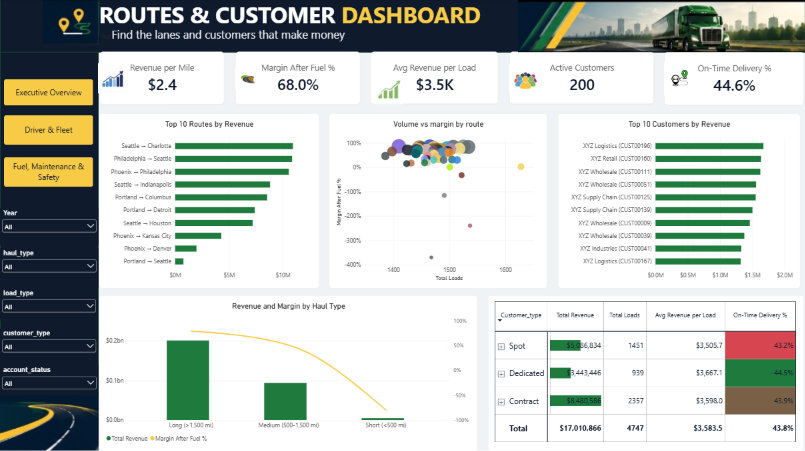
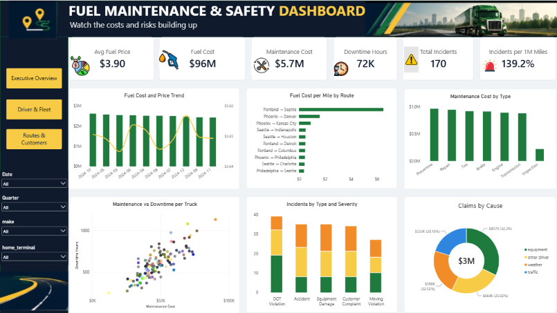

# Logistics Operations Dashboard | Power BI Capstone

A 4-page Power BI report that analyses a trucking company's operations from 2022 to 2024. It covers revenue, drivers and fleet, routes and customers, and fuel, maintenance and safety. Built as my TS Academy capstone project.

## Business Problem
A logistics company needs one view of how it makes money and where it loses it. This report answers eight questions: driver performance, route profitability, fleet utilization, maintenance, fuel efficiency, customer analysis, safety, and seasonal patterns.

## Dataset
- 14 related tables: Drivers, Trucks, Trailers, Customers, Facilities, Routes, Loads, Trips, Fuel purchases, Maintenance, Delivery events, Safety incidents, and two monthly metrics tables
- About 85,400 loads and trips, 196,000 fuel purchases and 170,800 delivery events (2022 to 2024)

## Tools
Power Query, Power BI (data modelling, DAX, dashboards)

## What I Did

### 1. Data cleaning (Power Query)
- Merged Loads and Trips into one Trips table (one trip per load, 85,410 rows)
- Replaced blank driver and truck IDs with `UNKNOWN` and added matching rows to the Drivers and Trucks tables so relationships stay clean
- Removed personal and unused columns (licence numbers, dates of birth, VINs, fuel card numbers, columns with one value)
- Built unique labels for customers, drivers, trucks and facilities, because names repeat across IDs
- Dropped the fuel purchase state column, because cities and states did not match
- Capped utilization above 100% at 100%, and split incident descriptions into severity and cause

### 2. Data model
- Star schema with Trips as the central fact table, linked to Customers, Routes, Drivers, Trucks and a Date table
- Fuel purchases, delivery events and safety incidents connect through `trip_id`; maintenance and utilization connect through trucks and dates

### 3. DAX measures
Total Revenue, Total Loads, Total Miles, Fleet MPG, Revenue per Mile, Fuel Cost, Fuel Cost per Mile, Margin After Fuel %, Maintenance Cost, On-Time Delivery %, Revenue per Driver, Avg Truck Utilization, Incidents per 1M Miles, and more.

## Dashboards

### 1. Executive Overview

- Revenue is flat at about $99M a year (-1.0% in 2023, +0.9% in 2024), so growth has stalled.
- Dedicated bookings bring in 49.6% of revenue, while Spot and Contract each bring about 25%. Automotive is the top freight type (20.8%).
- On-time delivery is only 44.6%, while margin after fuel is 68.0%. Profit per load is healthy, but delivery times are being missed.

### 2. Driver & Fleet Performance

- All 124 active drivers earn between $2.0M and $2.6M, and the top 10 sit within $2.51M to $2.63M. No single driver stands out.
- On-time delivery is 44% to 45% at every experience level. Individual drivers range from 37.3% to 50.2%.
- Fleet utilization averages 81.6% with no real trend. Every truck make earns $3.16M to $3.20M per truck, and MPG varies only between 6.38 and 6.54 across drivers.

### 3. Routes & Customers

- Routes over 1,500 miles bring in $200.4M (67% of revenue) at a 79.4% margin after fuel. Medium routes make 51.1%.
- Five short routes lose money after fuel (-80%), led by New York to Philadelphia, Portland to Seattle and Las Vegas to Los Angeles. Some of this may come from the data, because fuel purchases per trip do not scale with distance.
- Revenue is spread across 200 customers, each worth $1.2M to $1.8M. The top 10 customers are only 5.7% of revenue, so concentration risk is low.

### 4. Fuel, Maintenance & Safety

- Fuel is the biggest cost at $95.6M ($3.90 per gallon). The price fell from $4.20 (2022) to $3.85 (2023) and $3.65 (2024), and annual fuel spend dropped from $34.4M to $30.1M.
- Maintenance cost and downtime rise together across trucks (correlation 0.82). The costliest trucks reach about $90K and over 1,100 hours of downtime.
- There are 170 safety incidents (1.39 per 1M miles), 55 of them severe and 33 with injuries. DOT violations are the most frequent type, and equipment-related causes cost the most in claims ($857K of $2.65M).

## Recommendations
1. Set an on-time delivery target and review late deliveries by lane, because 44.6% is the biggest gap in the business.
2. Review pricing or minimum charges on short-haul routes, and check the fuel data for those lanes.
3. Review the highest-cost, highest-downtime trucks for replacement or extra maintenance.
4. Look for new volume or better pricing, because revenue has been flat for three years.

## Data Quality Notes and Assumptions
- Fuel cost uses actual fuel purchases linked by trip, covering about 90% of trips, so margin after fuel is slightly optimistic and does not include maintenance or other costs.
- On-time delivery uses the supplied `on_time_flag`. Its timestamps agree with scheduled times on only about 67% of events.
- Utilization above 100% (436 rows) is capped at 100%.
- About 2% of trips have no driver or truck ID and are labelled `UNKNOWN`.
- 486 loads show delivery before pickup. They are left as they are and do not affect any KPI.

## Skills Demonstrated
Data cleaning, data modelling (star schema), DAX, KPI design, dashboard design, data quality checks, business insight writing.

## How to Open
Download `Logistics-Operations-Dashboard.pbix` and open it in Power BI Desktop.

## Author
**Eniola Badejo** | [Portfolio](https://eniola-badejo-portfolio.vercel.app/)
